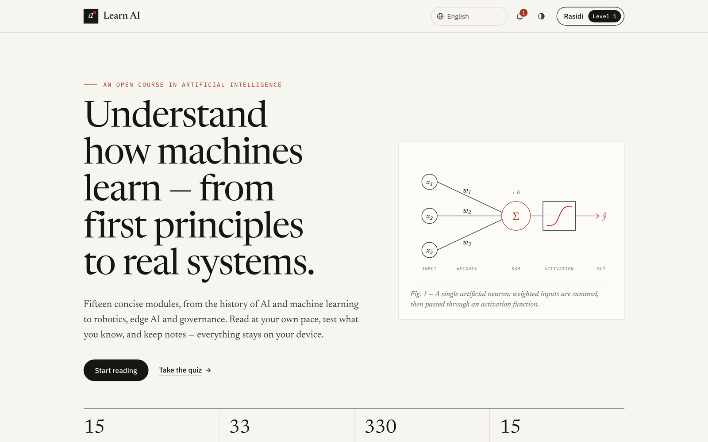
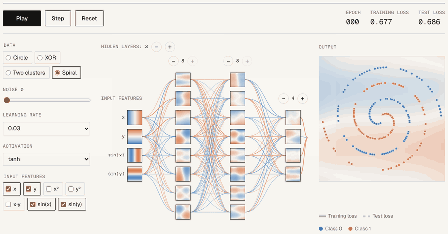
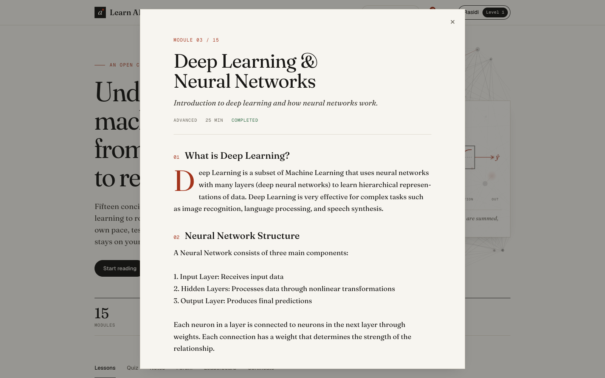
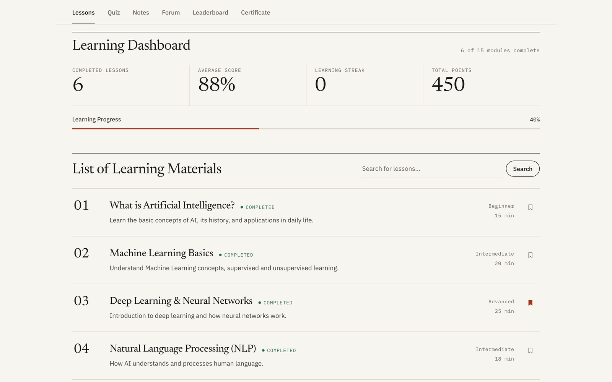
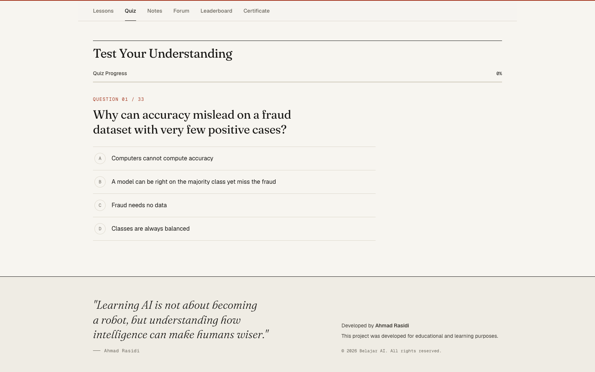
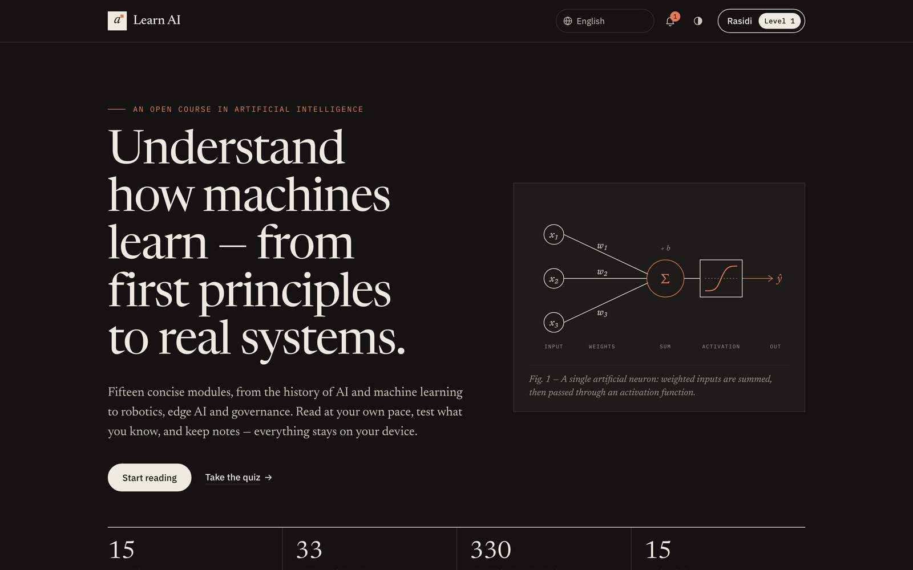

<div align="center">

# Belajar AI

**Kursus terbuka kecerdasan buatan, gratis: 17 modul, 37 soal kuis, dan 15 bahasa, dalam satu website statis.**

Tanpa daftar akun, tanpa pelacakan, tanpa proses build. Buka link-nya dan mulai membaca.

[**Buka kursus →**](https://rasidi3112.github.io/learn-artificial-intelligence/)
&nbsp;·&nbsp; [English](README.md)
&nbsp;·&nbsp; [Laporkan masalah](https://github.com/rasidi3112/learn-artificial-intelligence/issues)


<br>



</div>

---

## Kenapa proyek ini ada

Materi "belajar AI" biasanya jatuh ke salah satu dari dua kubu. Ada yang isinya hype tanpa pernah menjelaskan cara kerjanya. Ada juga yang berupa kuliah universitas, yang sejak hari pertama sudah menuntut kalkulus dan instalasi Python.

Belajar AI ada di tengah-tengahnya. Isinya bacaan singkat dan lugas, dimulai dari apa yang dihitung oleh satu neuron sampai bagaimana sistem nyata diuji, dijalankan, dan diawasi. Setiap modul membahas pertimbangan yang benar-benar diperdebatkan oleh praktisi.

Ditulis untuk pelajar, mahasiswa, orang yang sedang pindah karier, guru, dan siapa pun yang ingin benar-benar paham saat orang membicarakan LLM.

## Isinya

| | |
|---|---|
| **Playground neural network** | Latih jaringan saraf sungguhan di browser: geser bobot satu neuron, tambah layer, lihat batas keputusan mempelajari spiral ([coba](https://rasidi3112.github.io/learn-artificial-intelligence/learn/id/neural-network-playground/)) |
| **17 modul** | 380 menit bacaan, dari "Apa itu AI?" sampai AI agents, RAG, robotika, dan edge AI |
| **37 soal kuis** | Urutannya diacak setiap kali, dengan umpan balik langsung dan hasil yang bisa diunduh |
| **15 bahasa** | Antarmuka, materi, dan kuis, termasuk bahasa Arab (kanan-ke-kiri) |
| **Tampilan baca** | Tipografi yang nyaman untuk modul 25 menit |
| **Progres belajar** | Poin, level, favorit, dan enam pencapaian |
| **Catatan** | Tulis catatan selama membaca, lalu sunting atau hapus kapan saja |
| **Sertifikat** | Sertifikat PDF terbitan mandiri setelah semua modul selesai |
| **Data tetap di perangkat Anda** | Semua tersimpan di `localStorage`, bisa diekspor dan diimpor sebagai JSON |
| **Terang dan gelap** | Mengikuti tema sistem, bisa diganti manual |
| **Bisa offline** | Setelah sekali dibuka, aplikasi, kuis, playground, dan semua halaman materi dalam bahasa Anda tetap bisa dibuka tanpa internet |

<p align="center"><a href="https://rasidi3112.github.io/learn-artificial-intelligence/learn/id/neural-network-playground/"></a></p>

<table>
<tr>
<td width="50%"></td>
<td width="50%"></td>
</tr>
<tr>
<td></td>
<td></td>
</tr>
</table>

## Kurikulum

| # | Modul | Tingkat | Durasi |
|---|-------|---------|--------|
| 01 | [Apa itu Kecerdasan Buatan?](https://rasidi3112.github.io/learn-artificial-intelligence/learn/id/what-is-artificial-intelligence/) | Pemula | 15 menit |
| 02 | [Machine Learning Dasar](https://rasidi3112.github.io/learn-artificial-intelligence/learn/id/machine-learning-basics/) | Menengah | 20 menit |
| 03 | [Pembelajaran Mendalam & Jaringan Neural](https://rasidi3112.github.io/learn-artificial-intelligence/learn/id/deep-learning-neural-networks/) | Lanjut | 25 menit |
| 04 | [Natural Language Processing (NLP)](https://rasidi3112.github.io/learn-artificial-intelligence/learn/id/natural-language-processing/) | Menengah | 18 menit |
| 05 | [Computer Vision](https://rasidi3112.github.io/learn-artificial-intelligence/learn/id/computer-vision/) | Lanjut | 22 menit |
| 06 | [Prompt Engineering Dasar](https://rasidi3112.github.io/learn-artificial-intelligence/learn/id/prompt-engineering-basics/) | Pemula | 15 menit |
| 07 | [Etika dan Bias dalam AI](https://rasidi3112.github.io/learn-artificial-intelligence/learn/id/ai-ethics-and-bias/) | Menengah | 20 menit |
| 08 | [Panduan Karir di Bidang AI](https://rasidi3112.github.io/learn-artificial-intelligence/learn/id/ai-career-guide/) | Pemula | 15 menit |
| 09 | [Reinforcement Learning](https://rasidi3112.github.io/learn-artificial-intelligence/learn/id/reinforcement-learning/) | Lanjut | 28 menit |
| 10 | [Generative AI & Large Language Models](https://rasidi3112.github.io/learn-artificial-intelligence/learn/id/generative-ai-large-language-models/) | Menengah | 26 menit |
| 11 | [AI in Healthcare](https://rasidi3112.github.io/learn-artificial-intelligence/learn/id/ai-in-healthcare/) | Menengah | 25 menit |
| 12 | [AI untuk Bisnis & Industri](https://rasidi3112.github.io/learn-artificial-intelligence/learn/id/ai-for-business-and-industry/) | Menengah | 24 menit |
| 13 | [Robotika & AI](https://rasidi3112.github.io/learn-artificial-intelligence/learn/id/robotics-and-ai/) | Lanjut | 30 menit |
| 14 | [Edge AI & IoT](https://rasidi3112.github.io/learn-artificial-intelligence/learn/id/edge-ai-and-iot/) | Lanjut | 27 menit |
| 15 | [AutoML & No-Code AI](https://rasidi3112.github.io/learn-artificial-intelligence/learn/id/automl-and-no-code-ai/) | Pemula | 20 menit |
| 16 | [AI Agents: Model yang Bertindak](https://rasidi3112.github.io/learn-artificial-intelligence/learn/id/ai-agents/) | Menengah | 25 menit |
| 17 | [RAG dan Evaluasi Aplikasi LLM](https://rasidi3112.github.io/learn-artificial-intelligence/learn/id/rag-and-llm-evaluation/) | Menengah | 25 menit |

## Menjalankan di komputer sendiri

Tidak ada yang perlu di-install. Isinya hanya HTML, CSS, dan JavaScript biasa.

```bash
git clone https://github.com/rasidi3112/learn-artificial-intelligence.git
cd learn-artificial-intelligence
python3 -m http.server 8000
```

Lalu buka <http://localhost:8000>. Membuka `index.html` langsung juga bisa.

Untuk deploy, unggah foldernya apa adanya ke GitHub Pages atau Netlify. `netlify.toml` sudah tersedia, dan `./prepare-drop.sh` akan membuat file zip bersih untuk Netlify Drop.

## Dipakai di kelas

- **Tanpa akun:** siswa cukup membuka link. Tidak ada yang perlu diatur dan tidak ada data yang bisa bocor.
- **Kelas multibahasa:** setiap siswa bisa memilih bahasanya sendiri di halaman yang sama.
- **Bukti tugas:** siswa bisa mengunduh hasil kuis atau mengekspor progres sebagai file JSON.
- **Bisa di jaringan lokal dan offline:** karena berupa folder statis, website ini bisa jalan di intranet sekolah. Setelah sekali dibuka dengan internet, materi dan fontnya tetap bisa dipakai offline. Ekspor PDF bisa offline setelah pernah dipakai saat online.

## Kontribusi

Kontribusi sangat diterima. Yang paling membantu:

- **Periksa terjemahan** dalam bahasa yang Anda kuasai. Teks materi ada di `content-translations.js`, kuis di `quiz-translations.js`.
- **Tambah atau perbaiki modul.** Contoh yang akurat dan konkret lebih baik daripada penjelasan panjang.
- **Perbaiki bug.** Sertakan langkah untuk mereproduksinya di pull request Anda.

Kalau Anda mengubah teks materi atau file yang dimuat aplikasi (script, style, playground), buat ulang halaman statis per modul dan versi cache service worker, lalu jalankan pengecekan (Node 20 ke atas, tanpa instalasi apa pun):

```bash
npm run build:pages
npm test
```

CI menjalankan `npm test` di setiap pull request dan gagal kalau folder `learn/` atau `sw.js` belum diperbarui.

Fork repo ini, buat branch, lalu ajukan pull request dengan catatan singkat tentang apa yang diubah dan alasannya.

## Lisensi

[MIT](LICENSE). Silakan dipakai, diterjemahkan, dan diajarkan.

Dibuat oleh [Ahmad Rasidi](https://github.com/rasidi3112). Kalau proyek ini membantu Anda memahami AI, beri ⭐ supaya pelajar lain juga bisa menemukannya.
