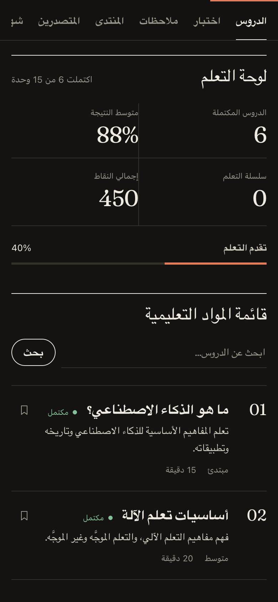
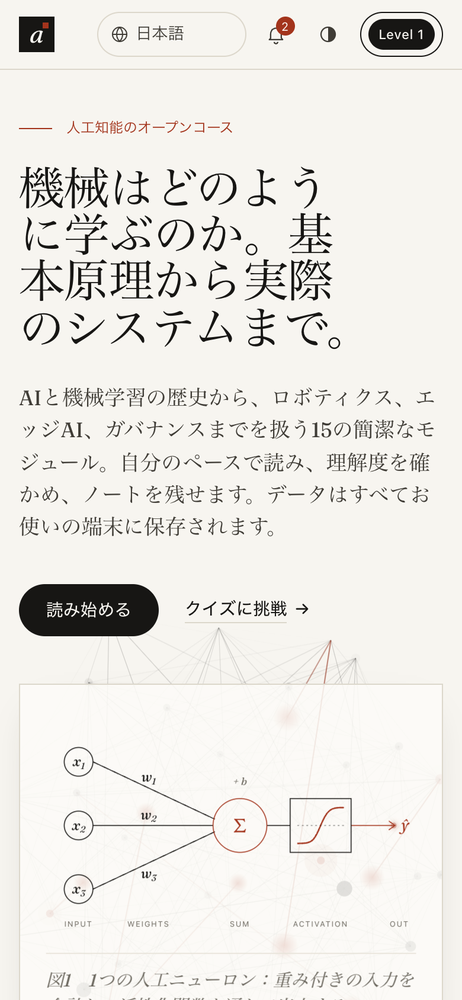

<div align="center">

# Learn AI · Belajar AI

**A free, open course on artificial intelligence: seventeen modules, a 37-question quiz and fifteen languages, in one static website.**

No sign-up, no tracking, no build step. Open the link and start reading.

[**Open the course →**](https://rasidi3112.github.io/learn-artificial-intelligence/)
&nbsp;·&nbsp; [Bahasa Indonesia](README.id.md)
&nbsp;·&nbsp; [Report an issue](https://github.com/rasidi3112/learn-artificial-intelligence/issues)


<br>


</div>

---

## Why this exists

Most "learn AI" material falls into one of two camps. Some of it is hype that never explains how anything works. The rest is a university course that assumes calculus and a Python setup on day one.

Learn AI sits in between. It is short, plain reading that builds up from what a neuron computes to how real systems are evaluated, deployed and governed. Every module ends with the trade-offs practitioners actually argue about.

It is written for students, career switchers, teachers and anyone who wants to stop nodding along when people talk about LLMs.

## What's inside

| | |
|---|---|
| **17 modules** | 380 minutes of reading, from "What is AI?" to AI agents, RAG, robotics and edge AI |
| **37-question quiz** | Shuffled every attempt, with instant feedback and a downloadable result |
| **15 languages** | Interface, lessons and quiz, including right-to-left Arabic |
| **Reading view** | Long-form typography that is comfortable for a 25-minute module |
| **Progress tracking** | Points, levels, favourites and six achievements |
| **Notes** | Write notes while reading, then edit or delete them later |
| **Certificate** | A self-issued PDF certificate once every module is complete |
| **Your data, your device** | Everything is stored in `localStorage`, with JSON export and import |
| **Light and dark** | Follows your system theme, with a manual toggle |

<table>
<tr>
<td width="50%"></td>
<td width="50%"></td>
</tr>
<tr>
<td></td>
<td></td>
</tr>
</table>

<p align="center">

&nbsp;&nbsp;

</p>

## Curriculum

| # | Module | Level | Time |
|---|--------|-------|------|
| 01 | [What is Artificial Intelligence?](https://rasidi3112.github.io/learn-artificial-intelligence/learn/en/what-is-artificial-intelligence/) | Beginner | 15 min |
| 02 | [Machine Learning Basics](https://rasidi3112.github.io/learn-artificial-intelligence/learn/en/machine-learning-basics/) | Intermediate | 20 min |
| 03 | [Deep Learning & Neural Networks](https://rasidi3112.github.io/learn-artificial-intelligence/learn/en/deep-learning-neural-networks/) | Advanced | 25 min |
| 04 | [Natural Language Processing](https://rasidi3112.github.io/learn-artificial-intelligence/learn/en/natural-language-processing/) | Intermediate | 18 min |
| 05 | [Computer Vision](https://rasidi3112.github.io/learn-artificial-intelligence/learn/en/computer-vision/) | Advanced | 22 min |
| 06 | [Basic Prompt Engineering](https://rasidi3112.github.io/learn-artificial-intelligence/learn/en/prompt-engineering-basics/) | Beginner | 15 min |
| 07 | [Ethics and Bias in AI](https://rasidi3112.github.io/learn-artificial-intelligence/learn/en/ai-ethics-and-bias/) | Intermediate | 20 min |
| 08 | [Career Guide in AI](https://rasidi3112.github.io/learn-artificial-intelligence/learn/en/ai-career-guide/) | Beginner | 15 min |
| 09 | [Reinforcement Learning](https://rasidi3112.github.io/learn-artificial-intelligence/learn/en/reinforcement-learning/) | Advanced | 28 min |
| 10 | [Generative AI & Large Language Models](https://rasidi3112.github.io/learn-artificial-intelligence/learn/en/generative-ai-large-language-models/) | Intermediate | 26 min |
| 11 | [AI in Healthcare](https://rasidi3112.github.io/learn-artificial-intelligence/learn/en/ai-in-healthcare/) | Intermediate | 25 min |
| 12 | [AI for Business & Industry](https://rasidi3112.github.io/learn-artificial-intelligence/learn/en/ai-for-business-and-industry/) | Intermediate | 24 min |
| 13 | [Robotics & AI](https://rasidi3112.github.io/learn-artificial-intelligence/learn/en/robotics-and-ai/) | Advanced | 30 min |
| 14 | [Edge AI & IoT](https://rasidi3112.github.io/learn-artificial-intelligence/learn/en/edge-ai-and-iot/) | Advanced | 27 min |
| 15 | [AutoML & No-Code AI](https://rasidi3112.github.io/learn-artificial-intelligence/learn/en/automl-and-no-code-ai/) | Beginner | 20 min |
| 16 | [AI Agents: Models That Act](https://rasidi3112.github.io/learn-artificial-intelligence/learn/en/ai-agents/) | Intermediate | 25 min |
| 17 | [RAG & LLM Application Evaluation](https://rasidi3112.github.io/learn-artificial-intelligence/learn/en/rag-and-llm-evaluation/) | Intermediate | 25 min |

Every module also has its own page in each language, readable without JavaScript: [browse all modules](https://rasidi3112.github.io/learn-artificial-intelligence/learn/en/).

**Languages:** Bahasa Indonesia · English · 中文 · Español · العربية · हिन्दी · Português · Français · Deutsch · 日本語 · 한국어 · Русский · Türkçe · Italiano · Tiếng Việt

## Run it locally

There is nothing to install. It's plain HTML, CSS and JavaScript.

```bash
git clone https://github.com/rasidi3112/learn-artificial-intelligence.git
cd learn-artificial-intelligence
python3 -m http.server 8000
```

Then open <http://localhost:8000>. Opening `index.html` directly also works.

To deploy, publish the folder as-is to GitHub Pages or Netlify. `netlify.toml` is included, and `./prepare-drop.sh` packages a clean zip for Netlify Drop.

## Use it in a classroom

- **No accounts:** students open a link and start. Nothing to provision and nothing to leak.
- **Mixed-language classes:** each student can pick their own language on the same page.
- **Homework evidence:** students can download their quiz result or export their progress as a JSON file.
- **Offline-friendly hosting:** it is a static folder, so it runs on a school intranet or a laptop with no internet connection. Fonts and PDF export need a connection.

## How it's built

| | |
|---|---|
| **Stack** | Vanilla HTML, CSS and JavaScript. No framework, bundler or runtime dependencies |
| **Lesson pages** | `scripts/build-pages.mjs` renders one static page per module and language (225 pages), with hreflang, JSON-LD and a sitemap. The output is committed, so hosting needs no build step |
| **Type** | Fraunces for reading and headlines, Geist for the interface, Geist Mono for metadata |
| **Storage** | `localStorage` under the key `belajarAI_v2` |
| **Security** | Strict Content Security Policy, with all user input escaped before rendering |
| **Accessibility** | Keyboard-navigable tabs and quiz, focus-trapped dialogs, live regions, reduced-motion support |
| **PDF** | html2pdf.js, loaded from cdnjs only when you download a certificate |

```
├── index.html               Page structure
├── styles.css               Design system: tokens, layout, light/dark, RTL
├── app.js                   App logic, Indonesian source content, quiz
├── content-translations.js  Lesson text in 14 languages
├── quiz-translations.js     Quiz questions in 14 languages
├── i18n-extra.js            Interface strings and translation fixes
├── lessons-agents-rag.js    Modules 16 and 17 with all translations and quiz questions
├── learn/                   Generated static page per module and language
├── scripts/build-pages.mjs  Generator for learn/, sitemap.xml and robots.txt
├── tests/                   node:test checks for the generated pages
└── docs/screenshots/        Images used in this README
```

## Contributing

Contributions are welcome. These help the most:

- **Review a translation** in a language you speak natively. Lesson text is in `content-translations.js`, and the quiz is in `quiz-translations.js`.
- **Add or improve a module.** Accurate, concrete examples beat long ones.
- **Fix a bug.** Include the steps to reproduce it in your pull request.

If you change lesson text, regenerate the static pages and run the checks (Node 20 or newer, nothing to install):

```bash
npm run build:pages
npm test
```

CI runs `npm test` on every pull request and fails if `learn/` is out of date.

Fork the repo, create a branch, and open a pull request with a short note on what you changed and why.

## Roadmap

- [x] Daily learning-streak tracking
- [ ] Offline mode with a service worker
- [ ] Shareable result card after the quiz
- [ ] More modules: AI security, data engineering for ML, evaluation of LLM apps
- [ ] Optional sync across devices

## License

[MIT](LICENSE). Use it, translate it, teach with it.

Made by [Ahmad Rasidi](https://github.com/rasidi3112). If this helped you understand AI a little better, a ⭐ helps other learners find it.
